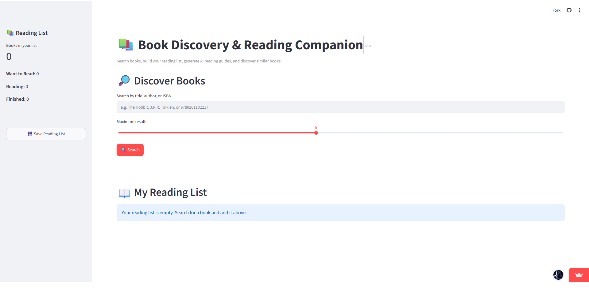
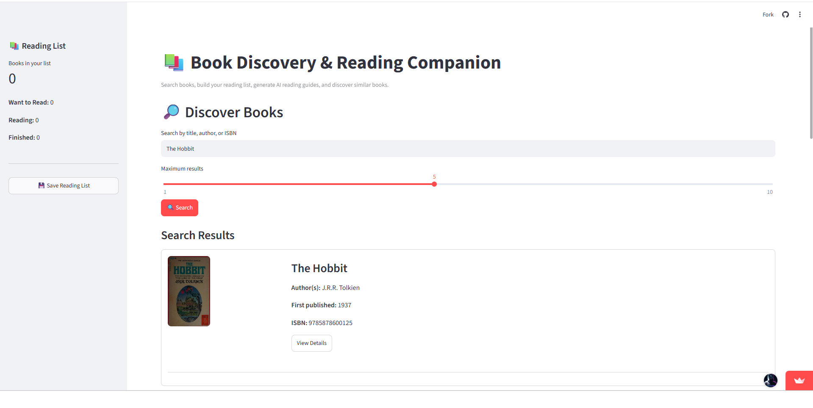
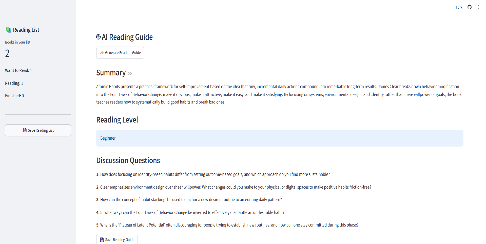
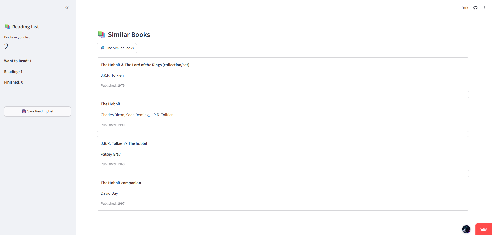
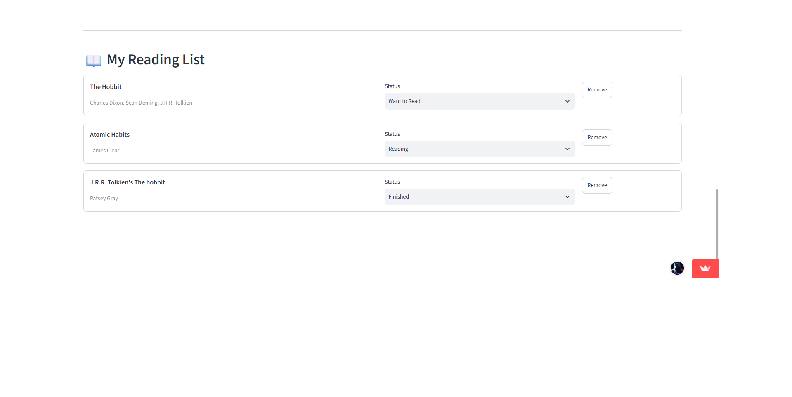
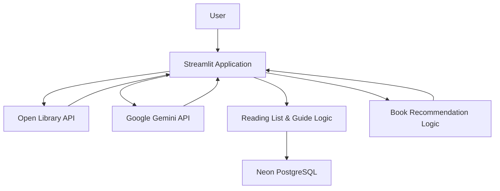

<div align="center">

# 📚 Book Discovery & Reading Companion

**Discover books. Build your reading list. Learn with AI.**

A Python-based book discovery and AI-assisted reading companion that helps readers explore books, organize their reading progress, and generate AI-powered reading guides.

[🚀 Live Application](https://baffxy-book-discovery-reading-companion.streamlit.app/) · [💻 GitHub Repository](https://github.com/Baffxy/book-discovery-reading-companion)

</div>

---

## 📖 Overview

The Book Discovery & Reading Companion is a web application designed to make discovering and engaging with books easier.

Users can search for books using their title, author, or ISBN, manage a personal reading list within the application, and generate AI-assisted reading guides containing summaries, suggested reading levels, and discussion questions.

The application integrates the Open Library API for book discovery, Google Gemini for AI-generated reading guides, and Neon PostgreSQL for persistent data storage.


## 📸 Application Preview

### 🏠 Home Page



### 🔍 Book Search



### 🤖 AI Reading Guide



### 📚 Similar Book Recommendations

Discover related titles based on shared authors and subjects.



### 📖 Reading List Management

Organize books into Want to Read, Reading, and Finished categories.



## ✨ Features

### 🔍 Book Discovery
- Search for books by title, author, or ISBN.
- Retrieve book metadata through the Open Library API.
- Explore available book information to help select your next read.

### 📚 Reading List Management
- Add books to your reading list.
- Organize books into three reading statuses:
  - Want to Read
  - Reading
  - Finished
- Update reading statuses and remove books.
- Persist reading-list data in Neon PostgreSQL.

### 🤖 AI Reading Guides
- Generate plain-language book summaries.
- Obtain suggested reading levels.
- Generate discussion and comprehension questions.
- Save generated reading guides in PostgreSQL.

### 📖 Similar Book Recommendations
- Discover potentially relevant books through a recommendation feature.
- Use book metadata, including authors and subjects, to identify similarities.

### 🧪 Testing
- Automated tests using `pytest`.
- Database functionality tested using mocked database interactions.
- **49 automated tests passing** at the time of the latest local verification.

## 🛠️ Technology Stack

| Technology | Purpose |
|---|---|
| Python | Core application logic |
| Streamlit | Web application interface |
| Open Library API | Book search and metadata |
| Google Gemini API | AI-assisted reading guides |
| Neon PostgreSQL | Persistent data storage |
| Psycopg | PostgreSQL database connectivity |
| pytest | Automated testing |
| python-dotenv | Local environment configuration |

## 🏗️ Architecture



### Architecture Overview

1. **Presentation layer:** Streamlit provides the user interface for book discovery and reading-list management.
2. **Book discovery:** The application communicates with Open Library to retrieve book information.
3. **AI integration:** Google Gemini generates AI-assisted reading guides.
4. **Persistence layer:** Neon PostgreSQL stores reading-list entries and saved reading guides.
5. **Recommendation logic:** Book metadata supports the similar-book recommendation feature.

## 🚀 Live Demo

**Try the application:**  
https://baffxy-book-discovery-reading-companion.streamlit.app/

The application is deployed using Streamlit Community Cloud, with Neon PostgreSQL providing persistent storage.

## ⚙️ Run Locally

### Prerequisites

- Python 3.11 or a compatible Python version.
- Git.
- A Google Gemini API key.
- A PostgreSQL database, such as Neon.

### 1. Clone the repository

```bash
git clone https://github.com/Baffxy/book-discovery-reading-companion.git
cd book-discovery-reading-companion
```

### 2. Create a virtual environment

**Windows — Git Bash:**

```bash
python -m venv .venv
source .venv/Scripts/activate
```

**Windows — PowerShell:**

```powershell
python -m venv .venv
.venv\Scripts\Activate.ps1
```

### 3. Install dependencies

```bash
python -m pip install --upgrade pip
pip install -r requirements.txt
```

### 4. Configure environment variables

Create a `.env` file in the project root using `.env.example` as a reference.

Add your credentials:

```dotenv
GEMINI_API_KEY=your_gemini_api_key
DATABASE_URL=your_neon_postgresql_connection_string
```

Replace the placeholders with your actual credentials.

**Security:** Never commit `.env` or expose API keys and database credentials in your source code.

### 5. Start the application

```bash
streamlit run app.py
```

Streamlit will display a local URL where you can open the application in your browser.

## 🧪 Running Tests

The automated test suite covers reading-list management, input
validation, AI reading-guide generation, and database functionality.

Run the complete test suite locally with:

```bash
python -m pytest -q
```

The latest verified result was:

```text
49 passed in 2.72s
```

Check the Python syntax of the main application and database module:

```bash
python -m py_compile app.py src/utils/database.py
```

## 🔐 Configuration and Data

The application requires configuration for the Gemini API and PostgreSQL database.

- Local development uses environment variables loaded from `.env`.
- Deployment credentials are configured through Streamlit Community Cloud secrets.
- Reading-list entries and saved reading guides are stored in Neon PostgreSQL.

### Storage Behaviour

- Reading-list changes are persisted to the configured database.
- Saved AI reading guides can be retrieved from persistent storage.
- Database availability and valid connection settings are required for database-backed operations.
- Database credentials should remain in environment variables or deployment secrets rather than being committed to the repository.

**Application scope:** The current application uses a shared reading list rather than separate authenticated accounts for individual users. Do not treat it as a private, multi-user reading management service.

## ⚠️ Limitations

- Book information depends on the availability and quality of Open Library data.
- AI-generated reading guides may contain inaccuracies and should be reviewed critically.
- Similar-book recommendations depend on the metadata available to the recommendation logic.
- The current application does not provide individual user accounts or private reading lists.

## 🔮 Potential Future Improvements

- Expand recommendations using richer book metadata.
- Improve error handling and user feedback for external API failures.
- Add reading progress statistics and visualizations.
- Introduce individual user accounts if the project scope expands.
- Improve recommendation quality with more advanced approaches.

## 🛠️ Troubleshooting

- **Dependency installation errors:** Confirm that your virtual environment is activated and install the dependencies with `pip install -r requirements.txt`.

- **Missing API credentials:** Check that `GEMINI_API_KEY` and `DATABASE_URL` are configured in your local `.env` file.

- **Database connection errors:** Verify that your PostgreSQL connection string is correct and that your Neon database is accessible.

- **Application startup issues:** Run `streamlit run app.py` from the project root and inspect the terminal output for errors.

- **Test failures:** Run `python -m pytest -q` to identify failing tests.

## 👨‍💻 Development

This project originated as a collaborative project for a Python Advanced course and was subsequently extended through independent development and improvements.

My subsequent contributions include integrating Neon PostgreSQL for persistent data storage, deploying the application using Streamlit Community Cloud, and improving the project's documentation and deployment configuration.

The project reflects both the original team's collaborative work and subsequent individual contributions.

## 📄 License

This project is licensed under the [MIT License](LICENSE).
---

<div align="center">

**Built with Python, Streamlit, PostgreSQL, and AI.**

</div>
